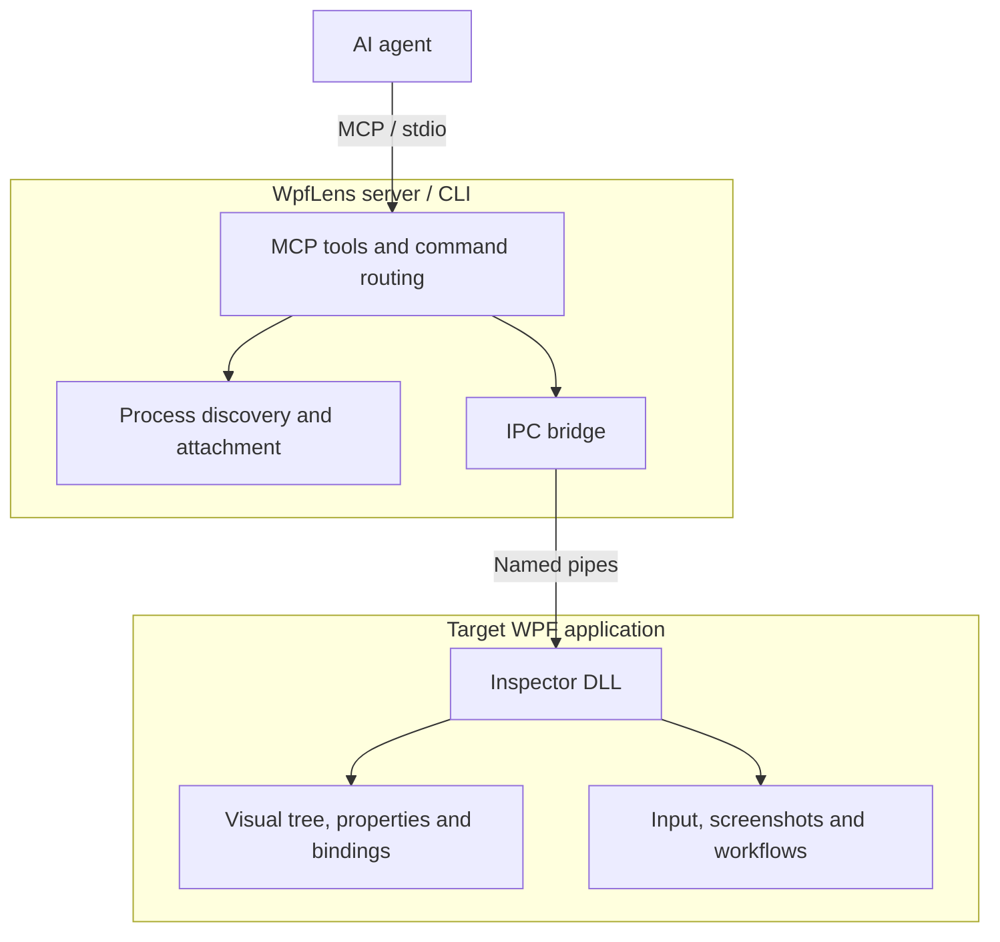

# WpfLens

[English](README.md) | [简体中文](README.zh-CN.md)

<!-- mcp-name: io.github.gaoshang212/wpf-lens -->

[](https://github.com/gaoshang212/WpfLens/actions/workflows/build.yml)
[](https://github.com/gaoshang212/WpfLens/releases)
[](LICENSE)
[](https://modelcontextprotocol.io/)

**Inspect, diagnose, and automate running WPF applications.**

WpfLens gives AI agents access to the visual tree, bindings, properties, screenshots and input actions through MCP. It also provides a CLI (`wpflens`) and a C# SDK (`WpfLens.Automation`). Automatic injection lets you inspect applications without changing their source.

Based on [faze79/WPFVisualTreeMcp](https://github.com/faze79/WPFVisualTreeMcp), with upstream baseline [v0.20.0](https://github.com/faze79/WPFVisualTreeMcp/releases/tag/v0.20.0). The first WpfLens release is 0.21.0.


*Real WPF input through MCP: drag, tap, pan, pinch and rotate, then fill a form and diagnose binding errors. [Open the demo](docs/assets/demo-drag-touch.gif?raw=true).*

## Quickstart

On Windows 10/11, choose one setup method below, then start the WPF app you want to inspect.

### Claude Code

Install the [.NET 8 SDK or later](https://dotnet.microsoft.com/download/dotnet), then run:

```powershell
dotnet tool install -g WpfLens.Mcp
claude mcp add --scope user wpflens -- wpflens
```

The first command installs WpfLens; the second registers a user-wide MCP server.

Claude Code must be able to find `wpflens` on PATH. Use `/mcp` to check the connection.

### Codex

Requirements:

- A plugin-capable Codex client.
- [.NET 10 SDK 10.0.300 or a newer stable .NET 10 SDK](https://dotnet.microsoft.com/download/dotnet/10.0).
- The [.NET 8 runtime](https://dotnet.microsoft.com/download/dotnet/8.0). For x86 injection, also install the x86 .NET 8 runtime.

```powershell
codex plugin marketplace add https://github.com/gaoshang212/WpfLens.git
codex plugin add wpflens@WpfLens
```

Restart Codex or open a new session. The plugin includes the MCP configuration and `$wpflens` skill. Check installation with `codex plugin list --marketplace WpfLens`.

Each MCP launch needs access to nuget.org to resolve the latest stable server; downloaded packages are cached.

### Manual configuration

1. Download and extract `WpfLens-vX.Y.Z-win-x64.zip` from the [latest release](https://github.com/gaoshang212/WpfLens/releases/latest). Install a [.NET 8, 9 or 10 Desktop Runtime](https://dotnet.microsoft.com/download/dotnet).
2. Add the following to your Claude Code project's `.mcp.json`, or Cursor's `.cursor/mcp.json`, replacing the path with the actual executable location:

   ```json
   {
     "mcpServers": {
       "wpflens": {
         "command": "C:/Tools/WpfLens/server/WpfVisualTreeMcp.Server.exe",
         "args": []
       }
     }
   }
   ```

Clients supporting MCP bundles can instead import the release's `.mcpb` file; see the [MCPB guide](docs/MCPB.md).

After setup, restart the client and ask:

- “List my running WPF applications and inspect the main window.”
- “Why is the Save button disabled?”
- “Find binding errors and explain their causes.”

### Compatibility

| Component | Supported environments |
| --- | --- |
| Target WPF application | .NET Framework 4.7.2, 4.8, 4.8.1; .NET 8, 9, 10 |
| C# SDK consumer | .NET 8, 9, 10; not .NET Framework |
| Target architecture | Windows x86 and x64; an x64 server/test process can control either |

The app and SDK test project may use different frameworks. See the tested [compatibility matrix](tests/compatibility-matrix.json) and [injection requirements](src/WpfVisualTreeMcp.Injector/README.md).

## Core features

| Area | Capabilities |
| --- | --- |
| Inspection | Process discovery, visual/logical trees, dependency properties, layout, resources and styles; includes adorners and popups |
| Diagnostics | Binding errors, DataContext, binding-path resolution, trigger explanations and aggregate reports |
| Search and verification | Exact AutomationId targeting, text/property filters, condition waits, assertions, property watches and snapshot diffs |
| Interaction | Click, hover, wheel, drag, touch, text, shortcuts and virtualized item selection; reversible property edits |
| Background input | Use MCP, the CLI or the C# SDK to click, hover, scroll, drag, type or send keystrokes within a WPF window even when another window covers it. The target stays in the background and the system pointer stays in place. [Usage and supported operations](docs/INPUT_MODES.md) |
| Capture and export | Element/window screenshots, full scrollable-content capture, XAML/JSON tree export |
| Test workflows | Record and replay with stable selectors; export runnable xUnit tests |

The MCP server exposes 39 tools through the same engine as the CLI. Browse the [MCP tool index](docs/MCP_TOOLS.md), or see the [tool reference](docs/TOOLS_REFERENCE.md) for parameters and examples.

- Touch requires application support; physical input needs an interactive desktop.
- In MCP, enable background input with `wpf_set_input_mode(mode="background")`. After the final action and verification, call `wpf_set_input_mode(mode="foreground")` on the same target to release its mouse and keyboard. Run this cleanup even if the workflow fails or is cancelled. Confirm the response reports `foreground` before returning control to the user.
- Actions and replay change application state, and full-content screenshots may temporarily scroll controls.
- Verify results with waits and assertions; see the [verification workflow](docs/TOOLS_REFERENCE.md#verification).

## How it compares

| | WpfLens | [Snoop](https://github.com/snoopwpf/snoopwpf) | [FlaUI](https://github.com/FlaUI/FlaUI) / WinAppDriver | Screenshot-based computer use |
| --- | --- | --- | --- | --- |
| Main interface | MCP, CLI, C# SDK | GUI | Test code | Images and input |
| Inspection view | WPF visual tree and internals | WPF visual tree and internals | UI Automation accessibility tree | Screen pixels |
| Bindings / DataContext | Yes | Yes | Requires an additional in-process probe | Not directly available |
| Automation focus | Inspection, diagnostics and input workflows | Manual inspection | UI testing | Visual interaction |

## C# test SDK

```powershell
dotnet add package WpfLens.Automation --version 0.23.0
```

```csharp
using WpfVisualTreeMcp.Automation;

await using var app = await WpfApplication.AttachAsync(processId);
await app.ByAutomationId("LoadButton").ClickAsync();
await app.ByAutomationId("StatusTextBox").WaitForTextAsync(
    "loaded", timeout: TimeSpan.FromSeconds(30));
```

The SDK attaches directly and includes the injection payload; no MCP server or CLI process is needed. Text waits match the exact value.

Package names use `WpfLens`, while implementation namespaces and assembly names retain `WpfVisualTreeMcp` for upstream compatibility.

See the [SDK guide](src/WpfVisualTreeMcp.Automation/README.md) for DataGrid/TreeView APIs, gestures, cancellation, session lifetime and property subscriptions.

## CLI examples

With no subcommand, `wpflens` starts the MCP stdio server. A recognized subcommand runs a single CLI operation. Results go to stdout as JSON; diagnostics go to stderr.

```powershell
wpflens list
wpflens attach --pid 1234 --auto-inject
wpflens find --pid 1234 --type Button
wpflens props --pid 1234 --handle elem_00000052
wpflens screenshot --pid 1234 --out app.png
```

- Replace the PID and handle with values returned by your queries. Handles expire when the target restarts or the element is collected.
- Input commands also accept `--automation-id` for exact, case-sensitive targeting.
- Use `wpflens help` or `wpflens <command> --help` for details.

## Updating

```powershell
wpflens update --check
wpflens update
wpflens update --status
```

- For a portable installation, invoke that copy's `server/WpfVisualTreeMcp.Server.exe update`. Only the invoked installation is updated.
- Global tools can also use `dotnet tool update -g WpfLens.Mcp`.

A `scheduled` result is not completion: check `--status` for `updated` or `failed`.

Close other MCP instances using the same files before updating; after success, restart the MCP client and previously inspected WPF apps.

The Codex plugin resolves server updates on restart. Plugin configuration and skill updates are separate; `wpflens update` does not update them.

Source builds and package-manager caches use their own update workflows. See [update behavior and recovery](docs/GETTING_STARTED.md#updating-an-installation) for details.

## Architecture



The server runs separately from the target app. Inspector is injected at runtime or initialized by the app in [self-hosted mode](docs/GETTING_STARTED.md#setting-up-your-wpf-application-self-hosted-mode).

WPF tree access runs on the target UI Dispatcher. See the [architecture guide](docs/ARCHITECTURE.md) for component and threading details.

## Development and building

Use Visual Studio Developer PowerShell with the C++ v143 toolset and Windows SDK.

The full compatibility suite also requires .NET 10 SDK, x64/x86 .NET 8/9/10 Desktop runtimes, and .NET Framework 4.8.1.

```powershell
git clone https://github.com/gaoshang212/WpfLens.git
cd WpfLens
./scripts/Build-NativeBootstrapper.ps1
dotnet build -c Release WpfVisualTreeMcp.sln
dotnet test WpfVisualTreeMcp.sln
dotnet run --project samples/SampleWpfApp
```

Open `WpfVisualTreeMcp.sln` in Visual Studio 2022, or use VS Code. Contributions are welcome.

| Source | Responsibility |
| --- | --- |
| `src/WpfVisualTreeMcp.Server/` | MCP server and CLI |
| `src/WpfVisualTreeMcp.Automation/` | C# SDK and shared process/IPC infrastructure |
| `src/WpfVisualTreeMcp.Inspector/` | Inspection and interaction inside the target app |
| `src/WpfVisualTreeMcp.Injector/` | Managed injection |
| `src/WpfVisualTreeMcp.InjectorHelper/` | x86 injection helper |
| `src/WpfVisualTreeMcp.Bootstrapper/` | Native CLR bootstrapper |
| `plugins/wpflens/` | Codex plugin and skill |
| `samples/`, `tests/`, `scripts/` | Sample apps, tests and build/verification scripts |

## Documentation

| Guide | Contents |
| --- | --- |
| [Getting started](docs/GETTING_STARTED.md) | Additional configuration, self-hosting, update recovery and troubleshooting |
| [MCP tool index](docs/MCP_TOOLS.md) | Names and brief descriptions of all 39 tools |
| [Tool reference](docs/TOOLS_REFERENCE.md) | All MCP tools, selectors, recording/replay and verification |
| [C# SDK](src/WpfVisualTreeMcp.Automation/README.md) | SDK installation, API examples and requirements |
| [Architecture](docs/ARCHITECTURE.md) | Components, IPC and threading |
| [Injection](src/WpfVisualTreeMcp.Injector/README.md) / [MCPB](docs/MCPB.md) | Injection payloads and desktop bundles |
| [Roadmap](docs/ROADMAP.md) | Planned work and priorities |
| [Changelog](CHANGELOG.md) / [Release notes](RELEASE_NOTES.md) | Version history |

## Acknowledgments and license

- Based on [faze79/WPFVisualTreeMcp](https://github.com/faze79/WPFVisualTreeMcp).
- Inspired by [Snoop WPF](https://github.com/snoopwpf/snoopwpf).
- Built on the [Model Context Protocol](https://modelcontextprotocol.io/).
- Thanks to the .NET/WPF community and @miloszkukla for the compatibility and screenshot work in [PR #22](https://github.com/faze79/WPFVisualTreeMcp/pull/22).

Licensed under the [MIT License](LICENSE).
