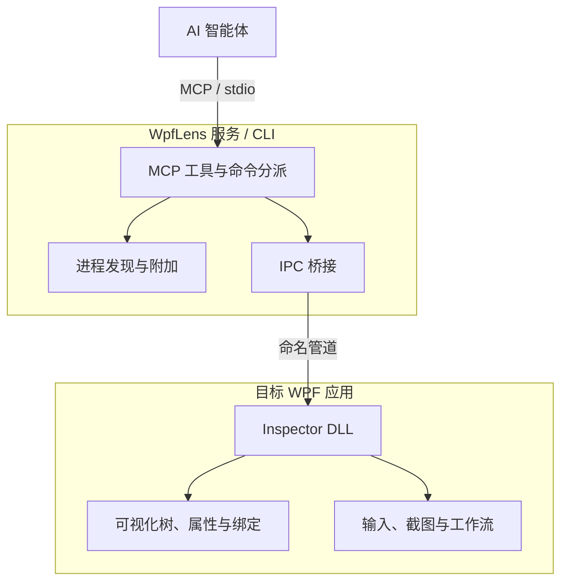

# WpfLens

[English](README.md) | [简体中文](README.zh-CN.md)

[](https://github.com/gaoshang212/WpfLens/actions/workflows/build.yml)
[](https://github.com/gaoshang212/WpfLens/releases)
[](LICENSE)
[](https://modelcontextprotocol.io/)

**检查、诊断并自动化操作正在运行的 WPF 应用。**

WpfLens 通过 MCP 为 AI 智能体提供可视化树、绑定、属性、截图和输入操作，同时提供 CLI（`wpflens`）与 C# SDK（`WpfLens.Automation`）。通过自动注入，无需修改目标应用源码即可检查。

项目基于 [faze79/WPFVisualTreeMcp](https://github.com/faze79/WPFVisualTreeMcp)，上游基线为 [v0.20.0](https://github.com/faze79/WPFVisualTreeMcp/releases/tag/v0.20.0)，WpfLens 首个版本为 0.21.0。


*通过 MCP 发送真实 WPF 输入：拖动、点击、平移、缩放、旋转，随后填写表单并诊断绑定错误。[查看演示动图](docs/assets/demo-drag-touch.gif?raw=true)。*

## 快速开始

在 Windows 10/11 上选择以下一种配置方式，然后启动待检查的 WPF 应用。

### Claude Code

安装 [.NET 8 SDK 或更高版本](https://dotnet.microsoft.com/download/dotnet)后执行：

```powershell
dotnet tool install -g WpfLens.Mcp
claude mcp add --scope user wpflens -- wpflens
```

第一条命令安装 WpfLens，第二条注册用户范围的 MCP 服务。

Claude Code 需要能从 PATH 找到 `wpflens`；使用 `/mcp` 检查连接状态。

### Codex

环境要求：

- 支持插件的 Codex 客户端。
- [.NET 10 SDK 10.0.300 或更新的 .NET 10 稳定版 SDK](https://dotnet.microsoft.com/download/dotnet/10.0)。
- [.NET 8 运行时](https://dotnet.microsoft.com/download/dotnet/8.0)；x86 注入还需安装 x86 .NET 8 运行时。

```powershell
codex plugin marketplace add https://github.com/gaoshang212/WpfLens.git
codex plugin add wpflens@WpfLens
```

重启 Codex 或打开新会话。插件包含 MCP 配置和 `$wpflens` 技能，执行 `codex plugin list --marketplace WpfLens` 检查安装。

每次启动 MCP 时需访问 nuget.org 解析最新稳定版服务，下载的包会缓存。

### 手动配置

1. 从[最新发布页](https://github.com/gaoshang212/WpfLens/releases/latest)下载并解压 `WpfLens-vX.Y.Z-win-x64.zip`，安装 [.NET 8、9 或 10 Desktop Runtime](https://dotnet.microsoft.com/download/dotnet)。
2. 在 Claude Code 项目的 `.mcp.json` 或 Cursor 的 `.cursor/mcp.json` 中添加以下配置，替换为实际可执行文件路径：

   ```json
   {
     "mcpServers": {
       "wpflens": {
         "command": "C:/Tools/WpfLens/server/WpfVisualTreeMcp.Server.exe",
         "args": []
       }
     }
   }
   ```

支持 MCP Bundle 的客户端也可导入发布页的 `.mcpb` 文件，详见 [MCPB 指南](docs/MCPB.md)。

配置完成后重启客户端，即可向智能体提出任务：

- “列出运行中的 WPF 应用，并检查主窗口。”
- “保存按钮为什么被禁用了？”
- “查找绑定错误并解释原因。”

### 兼容性

| 组件 | 支持范围 |
| --- | --- |
| 目标 WPF 应用 | .NET Framework 4.7.2、4.8、4.8.1；.NET 8、9、10 |
| C# SDK 使用方 | .NET 8、9、10，不支持 .NET Framework 测试项目 |
| 目标架构 | Windows x86 和 x64；x64 服务或测试进程可控制两种架构的应用 |

目标应用和 SDK 测试项目可以使用不同框架。详见已测试的[兼容性矩阵](tests/compatibility-matrix.json)及[注入要求](src/WpfVisualTreeMcp.Injector/README.md)。

## 核心功能

| 类别 | 能力 |
| --- | --- |
| 检查 | 进程发现、可视化树/逻辑树、依赖属性、布局、资源和样式，包含装饰器与弹出层 |
| 诊断 | 绑定错误、DataContext、绑定路径解析、触发器解释和聚合报告 |
| 搜索与验证 | 精确 AutomationId 定位、文本/属性过滤、条件等待、断言、属性监视及快照差异 |
| 交互 | 点击、悬停、滚轮、拖动、触摸、文本、快捷键、虚拟化选项选择，以及可撤销的属性编辑 |
| 后台输入 | 通过 MCP、CLI 或 C# SDK 对被遮挡的 WPF 窗口执行点击、悬停、滚动、窗口内拖动、文本输入和按键。目标窗口无需切到前台，系统鼠标指针保持原位。[用法与支持范围](docs/INPUT_MODES.md) |
| 截图与导出 | 元素/窗口截图、完整滚动内容捕获、XAML/JSON 树导出 |
| 测试工作流 | 使用稳定选择器录制与回放，导出可运行的 xUnit 测试 |

MCP 服务和 CLI 通过共享引擎提供 38 个工具。名称及用途见 [MCP 工具表](docs/MCP_TOOLS.md)，完整参数与示例见[工具参考](docs/TOOLS_REFERENCE.md)。

- 触摸需要应用支持，物理输入需要交互式桌面。
- 使用 MCP 时，调用 `wpf_set_input_mode(mode="background")` 开启后台输入。操作和验证结束后，即使中途失败或取消，也要对同一目标调用 `wpf_set_input_mode(mode="foreground")`，确认返回 `foreground` 后再将鼠标和键盘交还给用户。
- 输入和回放会改变应用状态，完整内容截图可能临时滚动控件。
- 使用等待和断言验证结果，详见[验证工作流](docs/TOOLS_REFERENCE.md#verification)。

## 与其他工具的区别

| | WpfLens | [Snoop](https://github.com/snoopwpf/snoopwpf) | [FlaUI](https://github.com/FlaUI/FlaUI) / WinAppDriver | 基于截图的电脑操作 |
| --- | --- | --- | --- | --- |
| 主要入口 | MCP、CLI、C# SDK | GUI | 测试代码 | 图像与输入 |
| 检查视角 | WPF 可视化树与内部状态 | WPF 可视化树与内部状态 | UI Automation 辅助功能树 | 屏幕像素 |
| 绑定 / DataContext | 支持 | 支持 | 需要额外进程内探针 | 无法直接读取 |
| 自动化侧重 | 检查、诊断和输入工作流 | 人工检查 | UI 测试 | 视觉交互 |

## C# 测试 SDK

```powershell
dotnet add package WpfLens.Automation --version 0.22.0
```

```csharp
using WpfVisualTreeMcp.Automation;

await using var app = await WpfApplication.AttachAsync(processId);
await app.ByAutomationId("LoadButton").ClickAsync();
await app.ByAutomationId("StatusTextBox").WaitForTextAsync(
    "loaded", timeout: TimeSpan.FromSeconds(30));
```

SDK 直接附加进程，包含注入所需文件，无需启动 MCP 服务或 CLI。文本等待使用精确值匹配。

包名使用 `WpfLens`，代码命名空间和程序集名保留 `WpfVisualTreeMcp`，便于同步上游。

DataGrid/TreeView、手势、取消、会话生命周期及属性订阅等用法见 [SDK 指南](src/WpfVisualTreeMcp.Automation/README.md)。

## CLI 示例

`wpflens` 不带子命令时启动 MCP stdio 服务；传入已识别的子命令时执行一次 CLI 操作。结果以 JSON 写入标准输出，诊断信息写入标准错误。

```powershell
wpflens list
wpflens attach --pid 1234 --auto-inject
wpflens find --pid 1234 --type Button
wpflens props --pid 1234 --handle elem_00000052
wpflens screenshot --pid 1234 --out app.png
```

- 将 PID 和句柄替换为实际查询结果。目标重启或元素被回收后，句柄会失效。
- 输入命令也支持 `--automation-id`，采用区分大小写的精确匹配。
- 运行 `wpflens help` 或 `wpflens <命令> --help` 查看详情。

## 更新

```powershell
wpflens update --check
wpflens update
wpflens update --status
```

- 便携版请调用该副本的 `server/WpfVisualTreeMcp.Server.exe update`；命令只更新当前调用的安装副本。
- 全局工具也可使用 `dotnet tool update -g WpfLens.Mcp`。

`scheduled` 不代表更新完成，需通过 `--status` 确认 `updated` 或 `failed`。

更新前关闭使用同一组文件的其他 MCP 实例；成功后重启 MCP 客户端和先前检查过的 WPF 应用。

Codex 插件在重启时解析服务更新，插件配置和技能需单独更新，`wpflens update` 不更新它们。

源码构建及包管理器缓存使用各自的更新流程。详细行为和故障恢复见[更新指南](docs/GETTING_STARTED.md#updating-an-installation)。

## 架构



服务在目标应用之外运行，Inspector 通过运行时注入或应用主动初始化的[自托管模式](docs/GETTING_STARTED.md#setting-up-your-wpf-application-self-hosted-mode)接入。

WPF 树访问在目标 UI Dispatcher 上执行，组件及线程机制见[架构文档](docs/ARCHITECTURE.md)。

## 开发与构建

使用 Visual Studio Developer PowerShell，并安装 C++ v143 工具集和 Windows SDK。

完整兼容性测试还需要 .NET 10 SDK、x64/x86 的 .NET 8/9/10 Desktop Runtime，以及 .NET Framework 4.8.1。

```powershell
git clone https://github.com/gaoshang212/WpfLens.git
cd WpfLens
./scripts/Build-NativeBootstrapper.ps1
dotnet build -c Release WpfVisualTreeMcp.sln
dotnet test WpfVisualTreeMcp.sln
dotnet run --project samples/SampleWpfApp
```

可在 Visual Studio 2022 中打开 `WpfVisualTreeMcp.sln`，也可使用 VS Code。欢迎提交贡献。

| 源码位置 | 职责 |
| --- | --- |
| `src/WpfVisualTreeMcp.Server/` | MCP 服务与 CLI |
| `src/WpfVisualTreeMcp.Automation/` | C# SDK，以及共享的进程/IPC 基础设施 |
| `src/WpfVisualTreeMcp.Inspector/` | 目标应用内的检查与交互 |
| `src/WpfVisualTreeMcp.Injector/` | 托管注入 |
| `src/WpfVisualTreeMcp.InjectorHelper/` | x86 注入辅助程序 |
| `src/WpfVisualTreeMcp.Bootstrapper/` | 原生 CLR 引导组件 |
| `plugins/wpflens/` | Codex 插件与技能 |
| `samples/`、`tests/`、`scripts/` | 示例、测试及构建/验证脚本 |

## 文档入口

| 文档 | 内容 |
| --- | --- |
| [入门指南](docs/GETTING_STARTED.md) | 补充配置、自托管、更新恢复和故障排查 |
| [MCP 工具表](docs/MCP_TOOLS.md) | 38 个工具的名称及简要用途 |
| [工具参考](docs/TOOLS_REFERENCE.md) | 全部 MCP 工具、选择器、录制/回放与验证 |
| [C# SDK](src/WpfVisualTreeMcp.Automation/README.md) | SDK 安装、API 示例和要求 |
| [架构](docs/ARCHITECTURE.md) | 组件、IPC 和线程机制 |
| [注入](src/WpfVisualTreeMcp.Injector/README.md) / [MCPB](docs/MCPB.md) | 注入文件与桌面扩展包 |
| [路线图](docs/ROADMAP.md) | 后续工作与优先级 |
| [变更日志](CHANGELOG.md) / [发布说明](RELEASE_NOTES.md) | 版本历史 |

## 致谢与许可证

- 项目基于 [faze79/WPFVisualTreeMcp](https://github.com/faze79/WPFVisualTreeMcp)。
- 灵感来自 [Snoop WPF](https://github.com/snoopwpf/snoopwpf)。
- 使用 [Model Context Protocol](https://modelcontextprotocol.io/)。
- 感谢 .NET/WPF 社区，以及 @miloszkukla 在 [PR #22](https://github.com/faze79/WPFVisualTreeMcp/pull/22) 中贡献的兼容性与截图改进。

本项目采用 [MIT 许可证](LICENSE)。
